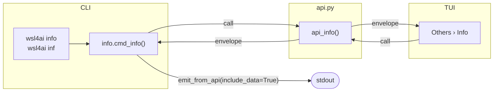

# Specification: `wsl4ai info` / `wsl4ai inf`

> **Status: implemented** (CLI `info` / `inf` and TUI `Others › Info`). Implementation: [`commands/info.py`](../../tool/commands/info.py), `api_info()` in [`commands/api.py`](../../tool/commands/api.py).

Read-only report of how this WSL distro is set up, seen from inside it. Aligns with [`specs.md`](specs.md) §2 except for the exemption in §9. For component versions see `wsl4ai version` in [`specs-version.md`](specs-version.md).

---

## 1. Purpose

Show in one place what an operator needs to diagnose an install: who runs it, where it is installed, which paths and mounts are active, the state of the database and config, and which AI client is installed.

**CLI and TUI** (`Others › Info`). It **only reads**: it never mounts, unmounts, writes the database or changes any file.

---

## 2. Options

- None.

---

## 3. Sections

Each row is `section` / `property` / `value`. A section that cannot be resolved still prints its rows, with the value `unavailable` and the reason; the command never aborts because one section failed.

| Section | Property | Source |
|---------|----------|--------|
| `identity` | `machine`, `user`, `wsl_name` | `RuntimeIdentity` ([`specs.md`](specs.md) §1.6) |
| `install` | `base`, `tool_version` | `INSTALL_BASE` (derived from the location of `wsl4ai.py`); `__version__` |
| `paths` | `host_ddbb`, `wsl_ddbb`, `host_projects`, `wsl_projects` | `conf/local.env` |
| `database` | `file`, `status` | `ddbb/wsl4ai.db`; `status` = `ok` · `missing` · `unusable` (same sanity check as `specs.md` §2.1) |
| `mounts` | `ddbb`, `uses_mounted` | `ddbb`: `mounted` / `not mounted` (is `WSL_DDBB` a mount point); `uses_mounted`: number of `uses` with `mounted=1` for the runtime WSL |
| `config` | `file`, `schema`, `theme`, `log_level` | `conf/config.json` |
| `ai_client` | `name`, `path` | `claude` or `copilot` found on the `PATH` or in `~/.local/bin`; `none` when neither is installed |

---

## 4. Output contract

- Always `output.result` plus `output.data.rows` (a list of `{section, property, value}` records), as for the other read commands.
- Exit code `0` when the report is produced, even if some rows say `unavailable`; `≠ 0` only when the command itself fails.

CLI rendering groups the rows by section: the section name as a heading, then `PROPERTY ..... value` lines. The TUI shows the same rows in a read-only list dialog.

---

## 5. Flow

